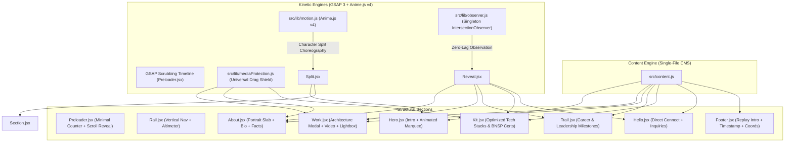

<div align="center">

```
████████████████████████████████████████████████████████████
█                                                          █
█   S Y U B Y   A L W I   A K B A R   A T T A L A          █
█   ── B U I L D I N G   W I T H   P U R P O S E ──        █
█                                                          █
████████████████████████████████████████████████████████████
```

# Monolith // Syuby Alwi Akbar Attala
### Architectural Portfolio • React 19 • GSAP 3 • Anime.js v4 • Vite 8

[](https://react.dev/)
[](https://vitejs.dev/)
[](https://gsap.com/)
[](https://animejs.com/)
[](https://developer.mozilla.org/en-US/docs/Web/CSS)
[](https://vercel.com/)
[](LICENSE)

<br/>

> *"When nothing goes right, go left."*  
> **— Syuby Alwi Akbar Attala**

<br/>

[Live Demo](https://this-is-syuby.vercel.app) • [Design Philosophy](#-the-architectural-manifesto) • [Key Features](#-core-architectural-features) • [System Architecture](#-system-architecture) • [Single-File Content Engine](#-single-file-content-engine-srccontentjs) • [Local Development](#-quickstart--local-development)

---

</div>

<br/>

## 🏛️ The Architectural Manifesto

Most developer portfolios look identical: floating soft pastel bubbles, fragile card grids that collapse under real-world scrutiny, and generic templates with bloated UI libraries.

**This portfolio was constructed with a radically different thesis:**  
What if a web portfolio felt like a **monolithic brutalist tower**—carved from heavy materials, built to withstand time, and calibrated with mechanical precision?

```
┌────────────────────────────────────────────────────────────────────────┐
│                        MONOLITHIC DESIGN PILLARS                       │
├──────────────────┬───────────────────────┬─────────────────────────────┤
│ 01. MATERIALITY  │ 02. VERTICAL SCALE    │ 03. KINETIC RESTRAINT       │
│ Raw Concrete and │ Real-time sidebar     │ Zero gratuitous fluff.      │
│ Deep Ink plates  │ altimeter measuring   │ Typography and structural   │
│ with organic     │ ascent up to 180m     │ geometry move with curated  │
│ tactile grain.   │ as you explore.       │ GSAP & Anime.js physics.    │
└──────────────────┴───────────────────────┴─────────────────────────────┘
```

### 1. Concrete & Ink Dualism (Color Palette)
Rather than arbitrary dark/light themes, the system uses two physical states inspired by print and industrial architecture:
- **Concrete State (Light Mode)**: Dominated by `#d4d4d0` (raw poured concrete), deep `#000000` borders, and rich cobalt `#0b3a8f`. Subtle micro-noise SVG turbulence (`feTurbulence`) overlays the canvas to replicate physical material texture.
- **Ink State (Dark Mode)**: Pure midnight `#000000` with high-contrast `#e6e6e2` typography and luminous cerulean `#6d9bd6` highlights.
- **Unified Signature Blue Motif (`--ci: #4a78c6`)**: Perfectly synchronized across the Hero circle, About section portrait halo, and the Preloader Iris Dot.

### 2. The Elevation Rail
Instead of a generic top navigation bar, desktop viewports feature a **76px structural steel rail** fixed to the left flank:
- **Monogram Hallmark (`S/A`)**: Architectural brand anchor.
- **Vertical Compass**: Section anchors styled with Japanese vertical writing mode (`writing-mode: vertical-rl`).
- **Tactile Altimeter (`000 m up` → `180 m up`)**: Dynamically measures user scroll progress, calculating physical height mathematically from document scroll depth.
- **Aesthetic Dial (`◐`)**: Instantaneous toggle between Concrete and Ink states with persisted `localStorage` preferences and theme-adaptive scrollbars.

---

## ⚡ Core Architectural Features

### 1. Scroll-Driven Horizontal Welcome Reveal (GSAP 3)
A welcoming preloader sequence greets first-time visitors:
- **Phase 1 (Minimal Center Counter)**: A minimal numeric counter (`000%` → `100%`) with an ultra-thin micro-track.
- **Phase 2 (Horizontal Scrubbing Track)**: As the user scrolls vertically or with touch gestures, GSAP scrubs a large-scale typographic statement (`"WELCOME TO MY PORTFOLIO."`) horizontally from right to left, revealing each glyph sequentially.
- **Expanding Iris Transition**: On reaching the final period (`.`), the period dot smoothly scales outward (`scale: 180`) in signature blue (`#4a78c6`), seamlessly parting to reveal the main portfolio.
- **Replay Intro**: Visitors can re-trigger the cinematic experience anytime via the `[Replay Intro ↺]` trigger located in the colophon/footer.

### 2. "Architecture & Details" Deep-Dive Modals
Every major engineering project features an in-depth architecture modal:
- **High-Contrast Callout Button (`.bt-case`)**: Styled with solid dynamic accent fills (`var(--ac)` & `var(--on)`) and brutalist offset shadows, exceeding **WCAG AAA** contrast guidelines (10.4:1 light mode, 7.3:1 dark mode).
- **Comprehensive Technical Breakdown**: Structured tabs detailing the *System Overview*, *Challenges Addressed*, *System Architecture & Implementation Decisions*, *Key Deliverables & Validation*, and *Technical Stack*.
- **Integrated Video Preview**: Automatically plays responsive 16:9 previews (MP4/WebM) with fallback screenshot transitions and a dedicated replay preview button.
- **React Portal & Scroll Lock**: Rendered directly onto `document.body` via `createPortal`, preventing clipping constraints and locking background scroll with ESC-key dismissal.
- **Brutalist Close Button (`.bt-modal-foot-close`)**: High-contrast bottom action button with vector icon, tactile hover state, and mobile-adaptive full-width layout.

### 3. Universal Media Asset Protection (Anti Click-Hold-Drag)
Assets are shielded against unauthorized extraction:
- **Capture-Phase Event Blocking**: `window.addEventListener('dragstart', ..., { capture: true })` halts HTML5 drag-and-drop operations on all ``, `<video>`, `.shot`, and `.modal-preview` elements.
- **Dynamic MutationObserver**: Automatically scans and stamps `draggable="false"` on any existing or future media injected into the DOM.
- **Universal CSS Rules**: Cross-browser `-webkit-user-drag: none; user-drag: none; user-select: none; -webkit-touch-callout: none;` disables ghost dragging and iOS long-press "Save Image" menus while keeping zoom clicks 100% functional.

### 4. Interactive Lightbox Zoom
Clicking any project screenshot opens an enlarged, high-resolution modal frame with brutalist borders and centered captions.

### 5. Infinite-Scale Kit & Performance Optimization
- **Singleton IntersectionObserver**: Replaced multiple observer instances with a single WeakMap-backed `observeOnce` listener (`src/lib/observer.js`), dramatically reducing RAM footprint.
- **Memoized Skill Badges (`Kit.jsx`)**: Pre-computes project-to-skill linkages (`usageMap`) once at mount; skill badges are wrapped in `React.memo` with CSS containment (`contain: content`), ensuring **zero frame drops** regardless of library size.
- **Dynamic Monochrome Vector Icons**: Simple Icons CDN integration with dark-mode CSS inversion, paired with a custom high-res vector SVG for Java/Java 17.

---

## 🏗️ System Architecture



---

## 📂 Project Structure

```
portfolio-react/
├── public/
│   ├── favicon.svg              # Bespoke vector monogram emblem
│   └── assets/
│       ├── face.png             # Transparent high-res portrait
│       ├── resume.pdf           # Curriculum Vitae document
│       └── projects/            # Real project screenshots, clips & mockups
├── src/
│   ├── components/
│   │   ├── About.jsx            # Biography, portrait frame & metrics
│   │   ├── Footer.jsx           # Coordinates, colophon & Replay Intro trigger
│   │   ├── Hello.jsx            # Direct contact links & mailto
│   │   ├── Hero.jsx             # Masthead, staggered headline, marquee
│   │   ├── Kit.jsx              # Tech stack categorized chips & BNSP certs
│   │   ├── Preloader.jsx        # GSAP scroll-driven text reveal & iris zoom
│   │   ├── Rail.jsx             # Left vertical spine navigation & altimeter
│   │   ├── Reveal.jsx           # Singleton-backed scroll animation trigger
│   │   ├── Section.jsx          # Section wrapper with self-animating titles
│   │   ├── SkillIcon.jsx        # Normalized CDN icons & custom Java SVG vector
│   │   ├── Split.jsx            # Word & character decomposition for anime.js
│   │   ├── Trail.jsx            # Career chronology (Work, Lead, Study)
│   │   └── Work.jsx             # Project showcase, architecture modals & lightbox
│   ├── lib/
│   │   ├── mediaProtection.js   # Universal anti-drag asset protection
│   │   ├── motion.js            # Anime.js v4 bindings & reduced-motion queries
│   │   └── observer.js          # Singleton IntersectionObserver registry
│   ├── App.jsx                  # Master monolith layout & intro coordinator
│   ├── content.js               # Centralized single-file CMS
│   ├── main.jsx                 # React 19 root bootstrap & protection init
│   └── styles.css               # Architectural styling, tokens, and keyframes
├── index.html                   # HTML5 entry with preconnected Montserrat fonts
├── package.json                 # Dependency manifests (React 19, GSAP, Anime.js)
├── vercel.json                  # Production caching & clean URL rules
└── vite.config.js               # Vite 8 build & manualChunks bundle optimization
```

---

## 🎛️ Single-File Content Engine (`src/content.js`)

You do **not** need to touch React components or CSS to update the portfolio. Everything is driven by a single declarative file:

```javascript
// src/content.js
const SITE = {
  name: "Syuby Alwi Akbar Attala",
  headline: ["Building", "resilient", "digital systems", "with purpose"],
  roles: ["Full Stack Developer", "Mobile App Developer", "Informatics Management Graduate"],
  status: "Open to entry-level roles",
  coords: "6.2397° S, 107.0015° E",

  // Projects Registry
  projects: [
    {
      year: "2026",
      title: "CRM & Alumni Tracer Study System",
      category: "Full Stack • Enterprise Web",
      text: "End-to-end institutional CRM tracking alumni career progressions.",
      stack: ["PHP", "CodeIgniter 3", "MySQL", "Bootstrap"],
      image: "assets/projects/elp-crm.png",
      preview: "assets/projects/elp-crm-preview.mp4",
      demo: "https://example.com/demo",
      repo: "https://github.com/syubidin/elp-crm",
      caseStudy: {
        overview: "Enterprise-grade CRM for institutional alumni tracking...",
        challenges: ["Fragmented legacy records", "Scalable reporting queries"],
        solutions: ["Normalized relational schema", "Automated email surveys"],
        highlights: ["1,200+ active alumni tracked", "Zero data loss during migration"]
      }
    }
  ],
  // ...
};
```

- **Add a project**: Insert an object into `SITE.projects` and drop the media into `public/assets/projects/`.
- **Add career records**: Append to `SITE.trail`.
- **Add technical competencies**: Add keywords to `SITE.kit`.
- **Add certifications**: Append to `SITE.certifications`.

---

## 🚀 Quickstart & Local Development

### Prerequisites
- Node.js `18.x` or higher
- Git

### Installation

```bash
# Clone the repository
git clone https://github.com/syubidin/portfolio-react.git

# Enter project directory
cd portfolio-react

# Install dependencies
npm install

# Start development server
npm run dev
```

Visit `http://localhost:5173` to see the live hot-reloading development environment.

### Production Build

```bash
# Compile and bundle with manual code-splitting
npm run build

# Preview production build locally
npm run preview
```

---

## 📊 Performance & Optimization Discipline

| Metric | Measurement | Impact |
| :--- | :--- | :--- |
| **Build Time** | `~1.1s` | Vite 8 lightning-fast esbuild compiler |
| **Gzipped CSS** | `~5.3 kB` | Zero redundant utility frameworks; 100% custom brutalist tokens |
| **Code Splitting** | `react-vendor`, `gsap`, `anime` | Handled via custom Vite `manualChunks` |
| **DOM Containment** | `contain: content / layout` | Zero lag on infinite skill badge additions |
| **Observer Efficiency**| `1 Singleton Observer` | Replaces hundreds of per-element observer instances |
| **Accessibility** | `prefers-reduced-motion` | Motion transforms auto-disable for sensitive users |

---

## 👤 About the Author

**Syuby Alwi Akbar Attala**  
*Full Stack Developer & Mobile App Developer*  
Based in Bekasi, Indonesia 🇮🇩

- 🎓 **Diploma in Informatics Management**, Politeknik LP3I Jakarta (*Best Graduate 2026, GPA 3.70 / 4.00*)
- 🏆 **Chairman**, Student Executive Board (BEM) 2024–2025
- 💼 **Specializations**: PHP, Laravel, CodeIgniter, Java, React, Flutter, MySQL, .NET System Configuration
- 🌐 **LinkedIn**: [syuby-alwi-akbar-attala](https://linkedin.com/in/syuby-alwi-akbar-attala)
- 🐙 **GitHub**: [@syubidin](https://github.com/syubidin)
- ✉️ **Email**: [syubyattala806@gmail.com](mailto:syubyattala806@gmail.com)

---

<div align="center">

```
B U I L T   B Y   H A N D ,   O N E   S L A B   A T   A   T I M E .
```

*Released under the [MIT License](LICENSE).*

</div>
