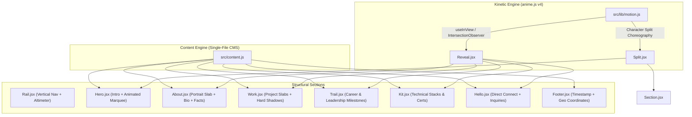

<div align="center">

```
████████████████████████████████████████████████████████████
█                                                          █
█   S Y U B Y   A L W I   A K B A R   A T T A L A          █
█   ── B U I L D I N G   W I T H   P U R P O S E ──        █
█                                                          █
████████████████████████████████████████████████████████████
```

# Monolith // Syuby Alwi Akbar Attala
### Architectural Portfolio • React 19 • Anime.js v4 • Vite 8

[](https://react.dev/)
[](https://vitejs.dev/)
[](https://animejs.com/)
[](https://developer.mozilla.org/en-US/docs/Web/CSS)
[](https://vercel.com/)
[](LICENSE)

<br/>

> *"I like things that hold weight: clean schemas, clear requirements, and systems people can lean on."*  
> **— Syuby Alwi Akbar Attala**

<br/>

[Live Demo](https://portfolio-react-syubidin.vercel.app) • [Design Philosophy](#-the-architectural-manifesto) • [System Architecture](#-system-architecture) • [Single-File Content Engine](#-single-file-content-engine-srccontentjs) • [Deployment](#-deployment-to-vercel)

---

</div>

<br/>

## 🏛️ The Architectural Manifesto

Most developer portfolios look identical: floating soft pastel bubbles, endless carousels of generic templates, and fragile card grids that collapse under real-world scrutiny. 

**This portfolio was constructed with a radically different thesis:**  
What if a web portfolio felt like a **monolithic brutalist tower**—carved from heavy materials, built to withstand time, and calibrated with mechanical precision?

```
┌────────────────────────────────────────────────────────────────────────┐
│                        MONOLITHIC DESIGN PILLARS                       │
├──────────────────┬───────────────────────┬─────────────────────────────┤
│ 01. MATERIALITY  │ 02. VERTICAL SCALE    │ 03. KINETIC RESTRAINT       │
│ Raw Concrete and │ Real-time sidebar     │ Zero gratuitous fluff.      │
│ Deep Ink plates  │ altimeter measuring   │ Typography and structural   │
│ with organic     │ ascent up to 180m     │ geometry move with curated  │
│ tactile grain.   │ as you explore.       │ spring and stagger easing.  │
└──────────────────┴───────────────────────┴─────────────────────────────┘
```

### 1. Concrete & Ink Dualism (Color Palette)
Rather than arbitrary dark/light themes, the system uses two physical states inspired by print and industrial architecture:
- **Concrete State (Light Mode)**: Dominated by `#d4d4d0` (raw poured concrete), deep `#000000` borders, and rich cobalt `#0b3a8f`. Subtle micro-noise SVG turbulence (`feTurbulence`) overlays the canvas to replicate physical material texture.
- **Ink State (Dark Mode)**: Pure midnight `#000000` with high-contrast `#e6e6e2` typography and luminous cerulean `#6d9bd6` highlights.

### 2. The Elevation Rail
Instead of a generic top navigation bar, desktop viewports feature a **76px structural steel rail** fixed to the left flank:
- **Monogram Hallmark (`S/A`)**: Architectural brand anchor.
- **Vertical Compass**: Section anchors styled with Japanese vertical writing mode (`writing-mode: vertical-rl`).
- **Tactile Altimeter (`000 m up` → `180 m up`)**: Dynamically measures user scroll progress, calculating physical height mathematically from document scroll depth.
- **Aesthetic Dial (`◐`)**: Instantaneous toggle between Concrete and Ink states with persisted `localStorage` preferences.

### 3. Kinetic Typography & Micro-Physics
Every block of copy commands presence. Through **Anime.js v4**, typography doesn't just "appear"—it is split character-by-character via `Split.jsx` and physically lands into position with exponential easing (`ease: 'outExpo'`), simulating stone slabs locking into place.

---

## ⚡ System Architecture

The project is built on **React 19** and bundled with **Vite 8**, deliberately avoiding bloated UI libraries or heavy CSS utility frameworks in favor of **100% custom handcrafted CSS tokens and hardware-accelerated animations**.



---

## 📂 Project Structure

```
portfolio-react/
├── public/
│   ├── favicon.svg              # Bespoke vector monogram emblem
│   └── assets/
│       ├── face.png             # Transparent high-res portrait
│       └── projects/            # Real project screenshots & mockups
│           └── elp-crm.png
├── src/
│   ├── components/
│   │   ├── About.jsx            # Biography, portrait frame & metrics
│   │   ├── Footer.jsx           # Coordinates, copyright & colophon
│   │   ├── Hello.jsx            # Direct contact links & mailto
│   │   ├── Hero.jsx             # Masthead, staggered headline, marquee
│   │   ├── Kit.jsx              # Tech stack categorized chips & BNSP certs
│   │   ├── Rail.jsx             # Left vertical spine navigation & altimeter
│   │   ├── Reveal.jsx           # IntersectionObserver animation trigger
│   │   ├── Section.jsx          # Section wrapper with self-animating titles
│   │   ├── Split.jsx            # Word & character decomposition for anime.js
│   │   ├── Trail.jsx            # Career chronology (Work, Lead, Study)
│   │   └── Work.jsx             # Showcase cards with isometric hover shift
│   ├── lib/
│   │   └── motion.js            # Anime.js v4 bindings & reduced-motion queries
│   ├── App.jsx                  # Master monolith layout
│   ├── content.js               # Centralized single-file CMS
│   ├── main.jsx                 # React 19 root bootstrap
│   └── styles.css               # Architectural styling, tokens, and keyframes
├── index.html                   # HTML5 entry with preconnected Montserrat fonts
├── package.json                 # Dependency manifests
├── vercel.json                  # Production caching & clean URL rules
└── vite.config.js               # Vite 8 build & target configuration
```

---

## 🎛️ Single-File Content Engine (`src/content.js`)

You do **not** need to touch React components or CSS to update the portfolio. Everything is driven by a single declarative file:

```javascript
// src/content.js
const SITE = {
  name: "Syuby Alwi Akbar Attala",
  headline: ["Building", "digital", "solutions", "with purpose"],
  roles: ["Full Stack Developer", "Mobile App Developer", "Informatics Management Graduate"],
  status: "Open to entry-level roles",
  coords: "6.2397° S, 107.0015° E",

  // Projects Registry
  projects: [
    {
      year: "2026",
      title: "CRM & Alumni Tracer Study System",
      text: "End-to-end institutional CRM tracking alumni and metrics.",
      stack: ["PHP", "CodeIgniter 3", "MySQL"],
      image: "assets/projects/elp-crm.png",
      demo: "",
      repo: "https://github.com/syubidin/elp-crm"
    }
  ],
  // ...
};
```

- **Add a project**: Insert an object into `SITE.projects` and drop the screenshot in `public/assets/projects/`.
- **Add career records**: Append to `SITE.trail`.
- **Add technical competencies**: Add keywords to `SITE.kit`.

---

## 🚀 Quickstart & Local Development

### Prerequisites
- Node.js `18.x` or higher
- Git

### Installation

```bash
# Clone the repository
git clone https://github.com/syubidin/portfolio-react.git

# Enter project directory
cd portfolio-react

# Install dependencies
npm install

# Start development server
npm run dev
```

Visit `http://localhost:5173` to see the live hot-reloading development environment.

### Production Build

```bash
# Compile and bundle
npm run build

# Preview production build locally
npm run preview
```

---

## ☁️ Deployment to Vercel

The project includes an optimized [`vercel.json`](file:///c:/Users/USER/Downloads/portfolio-react/vercel.json) with aggressive caching rules for static assets and clean URL routing.

### Step 1: Push to GitHub
```bash
git add .
git commit -m "feat: complete architectural portfolio with bespoke favicon"
git push -u origin main
```

### Step 2: Connect to Vercel
1. Go to [vercel.com/new](https://vercel.com/new) and select your **`portfolio-react`** repository.
2. Vercel automatically detects the Vite configuration:
   - **Framework Preset**: `Vite`
   - **Build Command**: `npm run build`
   - **Output Directory**: `dist`
3. Click **Deploy**. Your site will be live across Vercel's global edge network in seconds. Every push to `main` triggers zero-downtime automatic deployments.

---

## 📊 Performance & Weight Discipline

| Metric | Measurement | Impact |
| :--- | :--- | :--- |
| **Gzipped JavaScript** | `~87.5 kB` | Includes full React 19 DOM runtime & Anime.js v4 |
| **Gzipped CSS** | `~2.99 kB` | Zero redundant utility classes; pure custom CSS |
| **Fonts** | Montserrat `500, 800, 900` | Preconnected, sub-second FOIT prevention |
| **Accessibility** | `prefers-reduced-motion` | Motion transforms auto-disable for sensitive users |
| **Hydration Time** | `< 250ms` | Instantaneous first meaningful paint |

---

## 👤 About the Author

**Syuby Alwi Akbar Attala**  
*Full Stack Developer & Mobile App Developer*  
Based in Bekasi, Indonesia 🇮🇩

- 🎓 **Diploma in Informatics Management**, Politeknik LP3I Jakarta (*Best Graduate 2026, GPA 3.70 / 4.00*)
- 🏆 **Chairman**, Student Executive Board (BEM) 2024–2025
- 💼 **Specializations**: PHP, Laravel, CodeIgniter, React, Flutter, MySQL, .NET System Configuration
- 🌐 **LinkedIn**: [syuby-alwi-akbar-attala](https://linkedin.com/in/syuby-alwi-akbar-attala)
- 🐙 **GitHub**: [@syubidin](https://github.com/syubidin)
- ✉️ **Email**: [syubyattala806@gmail.com](mailto:syubyattala806@gmail.com)

---

<div align="center">

```
B U I L T   B Y   H A N D ,   O N E   S L A B   A T   A   T I M E .
```

*Released under the [MIT License](LICENSE).*

</div>
